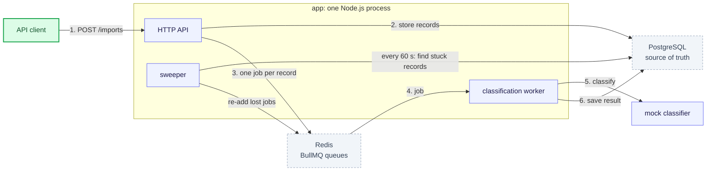

# Data Ingestion and Classification Service

Backend Technical Assignment v3.0.

A REST API that takes batches of records from external sources, checks and de-duplicates them, stores them in PostgreSQL, and puts each one in a category in the background. Classification can fail or be unsure, so the service also retries, sends unsure results to a person for review, keeps the original result when someone corrects it, and lets a client recover failed records without repeating finished work.

This file is the high-level view. The details live in [`docs/`](#documentation).

## Contents

- [How it works](#how-it-works)
- [Requirements map](#requirements-map)
- [Quick start](#quick-start)
- [Configuration](#configuration)
- [Tests](#tests)
- [API](#api)
- [Project structure](#project-structure)
- [Stack](#stack)
- [Documentation](#documentation)

## How it works



**Legend:** ▭ **green** = outside caller · ▭ **indigo** = code that runs · ▭ **grey dashed** = data store · numbers = the path of one import.

| Component             | What it does                                                                                            | Why it is there                                                                     |
| --------------------- | ------------------------------------------------------------------------------------------------------- | ----------------------------------------------------------------------------------- |
| HTTP API              | Accepts imports, validates each record, stores the valid ones in one transaction, answers `202` at once | The client never waits for classification                                           |
| PostgreSQL            | Holds every record, its status, its classification history and each attempt                             | The one source of truth; constraints block duplicates and edits to past results     |
| Redis (BullMQ)        | Holds the classification jobs                                                                           | Retries with backoff, concurrency and de-duplicated jobs, without custom queue code |
| Classification worker | Takes a job, claims the record, calls the classifier, saves the result or schedules a retry             | Slow or failing classification happens away from requests                           |
| Mock classifier       | Picks a category from keywords; words in the title force a failure or a review                          | The assignment allows a mock; it makes every path easy to try                       |
| Sweeper               | Every 60 s finds records waiting too long or held by a dead worker, and adds their jobs again           | If Redis loses jobs or the process crashes, work is delayed, never lost             |
| migrate (compose)     | Runs the database migrations once, before the app starts                                                | The schema is in place before the first request                                     |

The API, the worker and the sweeper run in one process. Under more load they can run as separate API-only and worker-only instances of the same code ([scaling](docs/ARCHITECTURE.md#scaling)).

**A record's life:** `PENDING` (stored, job queued) → `PROCESSING` (a worker holds it) → `CLASSIFIED`, `NEEDS_REVIEW` (low confidence or unknown category) or `FAILED` (retries used up, or a permanent error). A person approves or corrects a `NEEDS_REVIEW` record; a retry call sends `FAILED` records back to `PENDING`. Full diagram: [record states](docs/ARCHITECTURE.md#7-record-states).

## Requirements map

| #   | The client can…                                | Tested in                    |
| --- | ---------------------------------------------- | ---------------------------- |
| R1  | Submit multiple records                        | e2e                          |
| R2  | See invalid records with useful feedback       | unit, e2e                    |
| R3  | Never create duplicate records                 | unit, integration races, e2e |
| R4  | Track the progress and outcome of an import    | unit, e2e                    |
| R5  | Retrieve and filter records                    | e2e                          |
| R6  | Get one record and its classification          | e2e                          |
| R7  | Find results that need manual review           | integration, e2e             |
| R8  | Correct a classification, keeping the original | integration, e2e             |
| R9  | Recover failed records without repeating work  | integration, e2e             |

How each one is built: [technical decisions](docs/DECISIONS.md). The requests for each one: the matching folder in the [Postman collection](#api).

## Quick start

Needs Docker only.

```bash
docker compose up --build
```

This starts PostgreSQL, Redis, the one-shot `migrate` and the app on <http://localhost:3000>. Health checks: `/api/v1/health/live` and `/api/v1/health/ready`. If a port is busy: `API_HOST_PORT=3100 POSTGRES_HOST_PORT=5433 REDIS_HOST_PORT=6380 docker compose up --build`.

**Local development** (Node 22, pnpm):

```bash
corepack enable && pnpm install
docker compose up -d postgres redis
cp .env.example .env
pnpm db:migrate
pnpm start:dev
```

## Configuration

[`.env.example`](.env.example) lists the five environment variables (`NODE_ENV`, `PORT`, `DATABASE_URL`, `REDIS_URL`, `API_KEY`), each with its purpose and no secrets. Tuning values (timeouts, attempts, limits) are code constants, not environment variables.

## Tests

Integration and e2e tests start their own PostgreSQL and Redis with Testcontainers, so Docker must be running.

```bash
pnpm test               # unit, no Docker
pnpm test:integration   # worker, sweeper, races, Redis down
pnpm test:e2e           # every requirement R1–R9 through HTTP
pnpm test:all           # typecheck, lint, format and all of the above
```

The tests focus on where a bug would corrupt data or lose work: duplicates under concurrent imports, recovery after crashes and lost leases (counting classifier calls), Redis going down, a correction history the database keeps append-only, concurrent reviewers, and the record state machine.

## API

The [Postman collection](postman/collections/ingestion-service.postman_collection.json) is the API reference: one folder per requirement (R1–R9), an example for every route, and a [local environment](postman/environments/local.postman_environment.json) pointing at `localhost:3000`. Run it top to bottom after `docker compose up`.

All routes sit under `/api/v1`; errors use RFC 9457 `application/problem+json`. Words in a record's title steer the mock classifier, so every path (failure, retry, review) is easy to reach: see [mock classifier](docs/ARCHITECTURE.md#mock-classifier).

## Project structure

One NestJS app. Each feature module is one folder with its own layers (controllers, services, processors, contracts, …); shared plumbing sits in `infrastructure/`, grouped by layer.

```text
src/
  main.ts, app.module.ts   starts the one process: HTTP API + worker + sweeper
  modules/
    import/                submit, validate, de-duplicate, progress
    record/                list, filter, detail
    review/                approve and correct
    recovery/              retry failed records
    category/              the allowed categories
    health/                liveness and readiness
    classification/        record statuses and the state machine, queueing jobs, the worker, the sweeper, the mock classifier
  infrastructure/          shared plumbing, grouped by layer: services/, repositories/, models/, helpers/, utils/,
                           guards/, interceptors/, filters/, exceptions/, constants/, contracts/, schema/ (migrations), …
test/                      integration/, e2e/, support/ (unit tests sit beside their file)
postman/                   the API collection and a local environment
docs/                      the detailed documentation
```

Every file names its layer (`import.service.ts` exports `ImportService`), and `pnpm lint` enforces the naming and folder rules.

## Stack

Node.js 22 · TypeScript (strict) · NestJS 11 · PostgreSQL 16 with Sequelize, raw SQL and sequelize-cli migrations · BullMQ on Redis 7 · pino logs · Jest, Supertest and Testcontainers.

## Documentation

| Document                                                                         | What it covers                                                                                       |
| -------------------------------------------------------------------------------- | ---------------------------------------------------------------------------------------------------- |
| [DECISIONS](docs/DECISIONS.md)                                                   | The main technical decisions, why, and the alternatives considered                                   |
| [ARCHITECTURE](docs/ARCHITECTURE.md)                                             | Flow diagrams, record states, the mock classifier, failure handling, scaling, code layout, libraries |
| [DATA_MODEL](docs/DATA_MODEL.md)                                                 | The tables, the ER diagram and the constraints that enforce the rules                                |
| [ASSUMPTIONS](docs/ASSUMPTIONS.md)                                               | What was assumed where the assignment is open                                                        |
| [LIMITATIONS_SHORTCUTS_IMPROVEMENTS](docs/LIMITATIONS_SHORTCUTS_IMPROVEMENTS.md) | What the service does not do yet, the shortcuts taken, and what comes next                           |
| [postman/](postman/)                                                             | Example requests for every route                                                                     |
