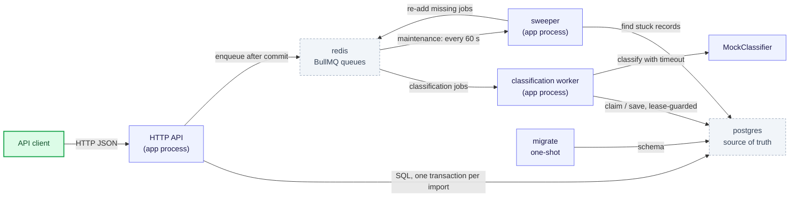
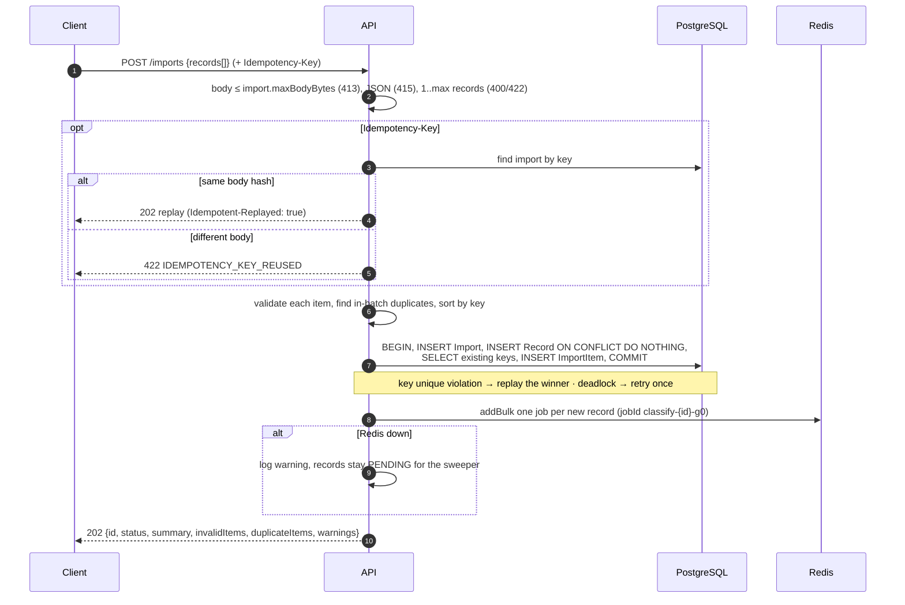
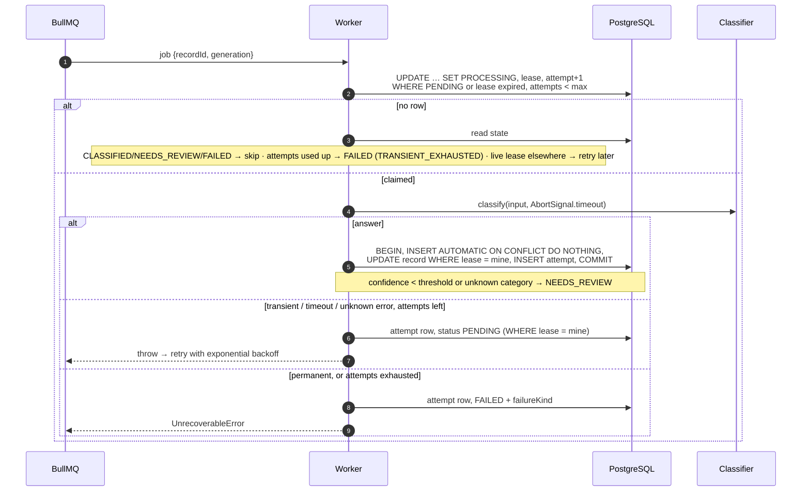
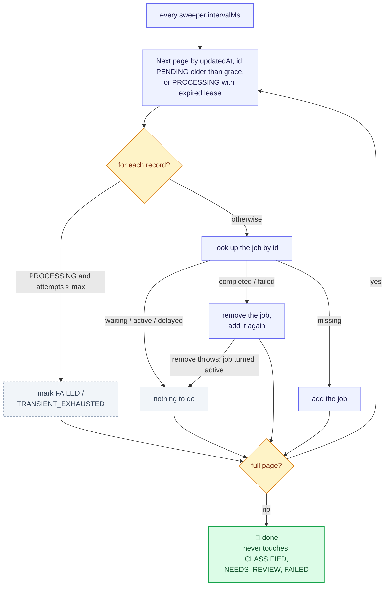
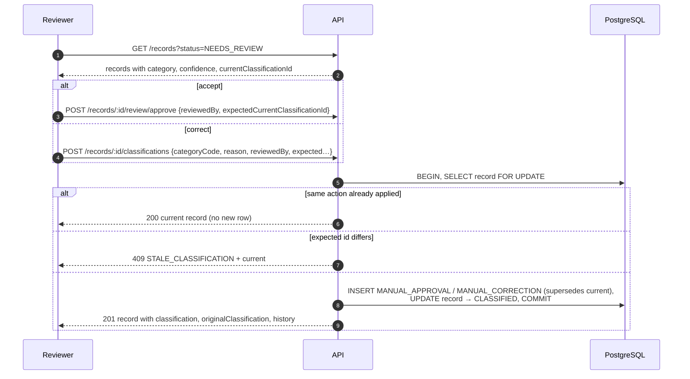
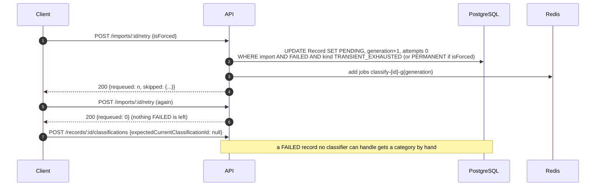
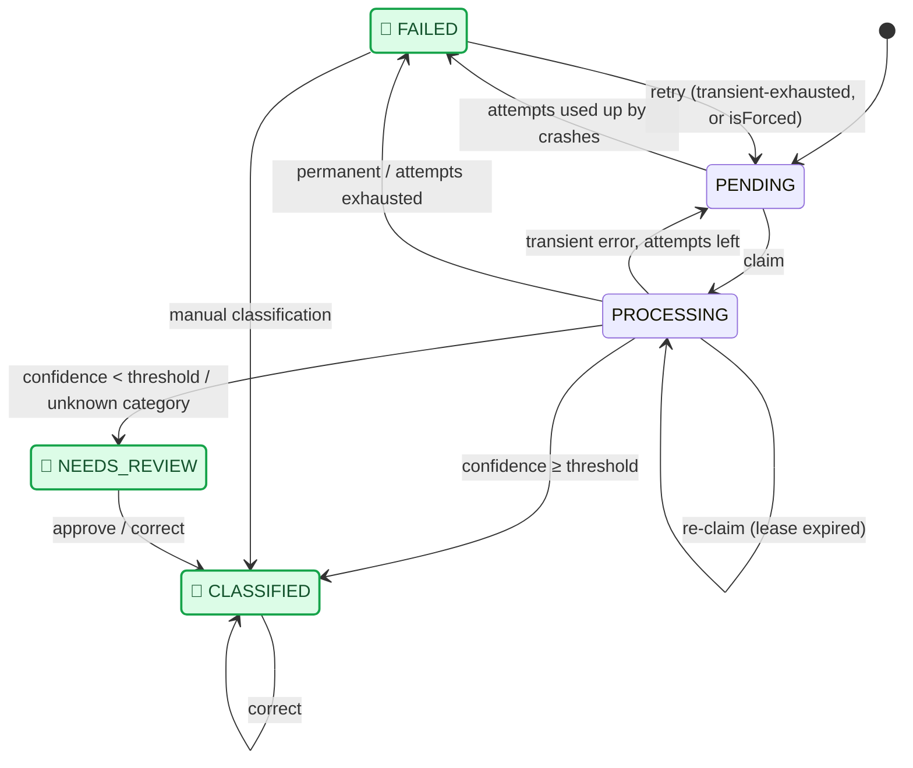

# Architecture

Terms used below: a **claim** is one conditional database update that gives a worker exclusive ownership of a record; a **lease** is the token and expiry time that claim sets, so a dead worker's record can be claimed again; a **retry generation** is a counter that grows each time failed records are re-queued, so every round gets a new job id and a fresh attempt budget.

## 1. Components

**Legend:** ▭ **green** = outside caller · ▭ **indigo** = our process · ▭ **grey dashed** = data store.

One process (`src/main.ts`) runs the HTTP API, the classification worker and the sweeper; the API never waits for classification, it only enqueues. Controllers hold no logic: they pass inputs to a service and return its answer, and one global interceptor turns a service result into HTTP (`isCreated` → `201`, `isReplayed` → `Idempotent-Replayed: true`). If Redis loses every job, the sweeper rebuilds the queue from PostgreSQL.

## 2. Submit an import

**Legend:** numbers = message order · solid arrow = request · dashed arrow = reply · `alt` / `opt` = a branch that runs only on its condition.

## 3. Classify a record (worker)

**Legend:** numbers = message order · solid arrow = request · dashed arrow = reply · `alt` / `opt` = a branch that runs only on its condition.

## 4. Sweeper

**Legend:** ▭ **indigo** = step · ⬨ **amber** = decision · ▭ **grey dashed** = no-op or failure mark · 🏁 **green** = end of one sweep.

## 5. Review and correct

**Legend:** numbers = message order · solid arrow = request · dashed arrow = reply · `alt` / `opt` = a branch that runs only on its condition.

## 6. Recover failed records

**Legend:** numbers = message order · solid arrow = request · dashed arrow = reply · `alt` / `opt` = a branch that runs only on its condition.

## 7. Record states

**Legend:** arrow = a transition, labelled with its trigger · 🏁 **green** = the pipeline stops here; only a person or a retry call moves the record on.

Source of truth: `RECORD_TRANSITIONS` in `src/modules/classification/constants/lifecycle/record-transition.constant.ts`; `src/modules/classification/utils/record-status-machine.util.spec.ts` checks it against this diagram.

## Mock classifier

It reacts to words in the record's **title**:

| Title contains       | Result                                                                             |
| -------------------- | ---------------------------------------------------------------------------------- |
| `[fail-once]`        | first attempt fails, the retry succeeds                                            |
| `[fail-transient]`   | always fails transiently → `FAILED` / `TRANSIENT_EXHAUSTED` after the max attempts |
| `[fail-permanent]`   | fails permanently at once → `FAILED` / `PERMANENT`                                 |
| `[review]`           | low confidence → `NEEDS_REVIEW`                                                    |
| `[unknown-category]` | returns an unknown code → stored as `other` → `NEEDS_REVIEW`                       |

Otherwise keywords decide the category; one matching keyword gives a confidence under the 0.7 threshold, so many demo records go to review on purpose. `MOCK_CLASSIFIER.FAILURE_RATE` (0.1) adds random transient failures.

## Import status (derived on read)

Let A = the records this import created.

| Condition (in order)                                              | Status                                                           |
| ----------------------------------------------------------------- | ---------------------------------------------------------------- |
| A is empty                                                        | `COMPLETED_WITH_ISSUES` if any item is invalid, else `COMPLETED` |
| any record in A is `PENDING` or `PROCESSING`                      | `PROCESSING`                                                     |
| any item `INVALID`, or any record in A `FAILED` or `NEEDS_REVIEW` | `COMPLETED_WITH_ISSUES`                                          |
| otherwise                                                         | `COMPLETED`                                                      |

`progress.finished` counts A's records in `CLASSIFIED`, `NEEDS_REVIEW` or `FAILED`; it can go down after a retry. `completedAt` is the latest `finishedAt` in A once nothing is in flight.

## Reliability

| Situation                            | Behaviour                                                                                                              |
| ------------------------------------ | ---------------------------------------------------------------------------------------------------------------------- |
| Classifier slow                      | Per-call timeout (`AbortSignal`) → transient → retry with backoff                                                      |
| Unknown category returned            | Stored as `other`, confidence 0, original in `rawOutput` → `NEEDS_REVIEW`                                              |
| Confidence not a number in 0..1      | Permanent failure, raw answer in the error                                                                             |
| Worker crashes mid-job               | Lease (20 s) expires before BullMQ's stall check (30 s); the re-run claims and classifies; the sweeper is the backstop |
| Record crashes the worker every time | Stops at `classification.maxAttempts` → `FAILED` / `TRANSIENT_EXHAUSTED`                                               |
| Redis down during an import          | `202`, records stay `PENDING`; `/api/v1/health/ready` reports Redis `degraded`; the sweeper enqueues later             |
| PostgreSQL down                      | `503 DATABASE_UNAVAILABLE`; the transaction leaves no partial state                                                    |
| Same job twice / two workers         | Job-id de-duplication + conditional claim with lease; one automatic row (unique index)                                 |
| Unexpected worker error              | Recorded as `UNKNOWN_ERROR`, retried like a transient error, counted against the max                                   |
| Concurrent imports, same keys        | Unique constraint; keys sorted; one retry on deadlock                                                                  |
| Two reviewers at once                | Row lock + expected-id check → one `201`, one `409`                                                                    |
| Huge or malformed body               | `413`, `422 TOO_MANY_RECORDS`, `400 MALFORMED_JSON`, `415`                                                             |
| Shutdown                             | HTTP drains; each queue worker's `close()` waits for its active jobs                                                   |
| Unhandled exception                  | problem+json `500`, no stack trace, logged with the request id                                                         |

## Scaling

- **More instances**: the process is stateless; run several behind a load balancer. Each one also consumes jobs, and leases and conditional updates make concurrent workers safe. `classification.concurrency` jobs run per process; add a BullMQ rate limiter for a paid provider.
- **Split roles later**: when classification load outgrows the API, turn `queue.isConsumerEnabled` into an environment variable and run API-only and worker-only instances of the same code; no second entry point is needed.
- **Big files**: store the raw payload and validate/insert in background chunks (the current limit is 500 records per call).
- **Large tables**: partition `Record` by `recordDate`; read replicas for listing; a trigram index for title search; cached counters for huge imports.
- **1M records/day** is about 12 per second on average: well within one PostgreSQL instance and a few workers; the provider's rate limit is the real ceiling.

## Code layout and naming

- One NestJS app in `src/`. Feature modules in `src/modules/` hold their own controllers, services and contracts; shared plumbing (env, settings, HTTP, logging, database, queue, crypto, timeouts) sits in `src/infrastructure/`.
- No shared or common folder: a concept other modules need lives in the module that owns it (record statuses in `classification/`, item outcomes in `import/`), and the others import it from there.
- `src/modules/` is **topic-first**: one folder per feature (`import/`, `record/`, `classification/`), named after what it is about, holding its `*.module.ts` and only layer folders (`controllers/`, `services/`, `processors/`, `drivers/`, `utils/`, `contracts/{dtos,interfaces,types,enums}`, …).
- `src/infrastructure/` is **layer-first**: its Nest modules sit at the root and everything else in layer folders (`services/`, `repositories/`, `models/`, `helpers/`, `utils/`, `guards/`, `interceptors/`, `filters/`, `decorators/`, `exceptions/`, `processors/`, `constants/`, `contracts/`, `schema/` for migrations, …).
- In `infrastructure/`, a layer folder that mixes areas groups its files by area (`helpers/http/`, `services/queue/`, `constants/sql-db/`, `contracts/enums/env/`); a layer with one area stays flat (`models/`, `guards/`). In a feature module, a layer folder groups by concern past six files (`contracts/enums/lifecycle/`).
- Every file carries its layer: `<name>.<layer>.ts` exports `<Name><Layer>` (`record-status.enum.ts` → `RecordStatusEnum`), and holds that one layer only. A `*.util.ts` imports nothing outside the repo; a file that needs a third-party package is a `*.helper.ts`.
- Repositories extend `SqlBaseRepository` (`infrastructure/repositories/persistence/`), which owns the connection and offers only what they use: `createTransaction()`, `selectRows`, `selectOne`, `selectRequiredOne` (fails fast when an `INSERT … RETURNING` returns nothing) and `execute`. Services never inject the connection.
- Transactions are explicit: open with `createTransaction()`, `commit()` at the end of the `try`, `rollback` in the `catch` and rethrow. Errors are not handled where they happen; the global problem+json filter turns them into responses.
- The queue transport is generic (`infrastructure/services/queue/queue-producer.service.ts`); what a classification job means (id, payload, options) stays in `modules/classification/services/classification-job.service.ts`, and the processors stay in the feature.
- `NODE_ENV` is `local`, `development`, `staging`, `production` or `test` (default `local`) and also sets the log level: `debug` for local and development, `info` for staging and production, `silent` for test.
- Every table has an internal `bigint` `id` that never leaves the server and a UUID `publicId` the API returns as `id` ([data model](DATA_MODEL.md)).
- `pnpm lint` enforces file and folder names, layer suffixes, naming (boolean prefixes included) and the util rule.

## Libraries

| Library                                   | Why                                                                           |
| ----------------------------------------- | ----------------------------------------------------------------------------- |
| `@nestjs/*`                               | framework, DI, validation pipes, health checks (terminus)                     |
| `sequelize`, `sequelize-typescript`, `pg` | connection pool, transactions, models for simple reads; raw SQL for hot paths |
| `sequelize-cli`                           | runs the migration files the same way in compose, dev and tests               |
| `bullmq`, `ioredis`                       | job queue with retries, backoff, stalled-job detection, schedulers            |
| `class-validator`, `class-transformer`    | DTO and per-item validation                                                   |
| `nestjs-pino`                             | structured JSON logs with request id                                          |
| `testcontainers`                          | real PostgreSQL and Redis in tests, only Docker needed                        |
