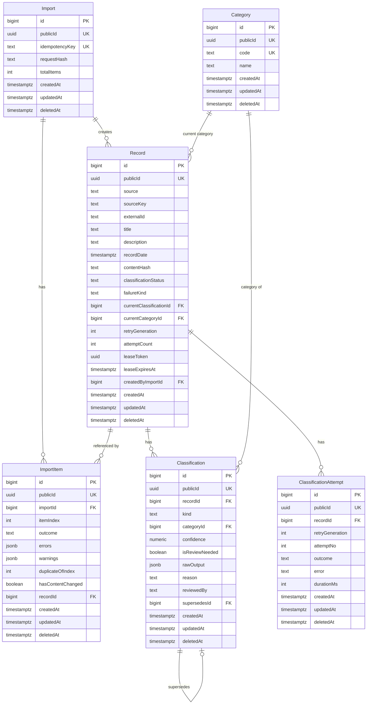

# Data model

Migrations are sequelize-cli files, `src/infrastructure/schema/migrations/YYYYMMDDHHMMSS-create-<table>-table.js`, run by `pnpm db:migrate`. There is one table per file, plus one migration that adds the `Record` → `Classification` foreign key once both tables exist; running them again changes nothing. Tables are PascalCase singular, columns camelCase, index and constraint names snake_case.

**Legend:** `PK` primary key · `UK` unique · `FK` foreign key · `||--o{` one to many · `||--o|` one to at most one. Every table carries the same base columns: `id`, `publicId`, `createdAt`, `updatedAt`, `deletedAt`.

## Identifiers

- `id` is an internal `bigint` key. It is used for joins and foreign keys, and it never leaves the server.
- `publicId` is a UUID. The API returns it as `id`, and clients send it back as `:id`.
- Every foreign key is a `bigint` that points at the other table's internal `id`.
- `deletedAt` is empty for a live row. `updatedAt` is kept by the database.

## Tables

- **Category**: the fixed category list. It is seeded on startup by an in-process seeder, not by a migration; seeding again changes nothing.
- **Import**: one submitted batch; optional idempotency key and the hash of the request body.
- **ImportItem**: one row per submitted item with its outcome (`ACCEPTED`, `INVALID`, `DUPLICATE_IN_BATCH`, `DUPLICATE_EXISTING`), errors, warnings and the record it refers to.
- **Record**: stored, valid, unique records with their classification status, lease and retry generation, and the current category (denormalised for filtering).
- **Classification**: append-only results, automatic or manual.
- **ClassificationAttempt**: one row per automatic attempt, numbered per retry generation.

## Constraints that carry rules

| Constraint                                                                                          | Rule                                                               |
| --------------------------------------------------------------------------------------------------- | ------------------------------------------------------------------ |
| `record_source_external_uq` UNIQUE `(sourceKey, externalId)`                                        | No duplicate records, even under concurrent imports                |
| `import_idempotency_key_uq`                                                                         | One import per idempotency key                                     |
| `classification_one_automatic_uq` UNIQUE `(recordId) WHERE kind='AUTOMATIC'`                        | At most one automatic result per record, even if two workers race  |
| `record_current_classification_fk` `(currentClassificationId, id)` → `Classification(id, recordId)` | A record can only point at its own classification                  |
| `classification_append_only_trg`                                                                    | `UPDATE` and `DELETE` on classifications raise an error            |
| `record_failed_kind_ck`                                                                             | `failureKind` is set if and only if the status is `FAILED`         |
| `record_done_has_result_ck`                                                                         | `CLASSIFIED` / `NEEDS_REVIEW` always have a current classification |
| `record_lease_ck`                                                                                   | A lease token exists if and only if the status is `PROCESSING`     |
| `classification_auto_conf_ck`, `classification_manual_reason_ck`                                    | Automatic rows have a confidence; corrections have a reason        |
| `classification_attempt_record_gen_no_uq`                                                           | One attempt row per record, generation and attempt number          |
| `record_touch_updated_at_trg`                                                                       | `updatedAt` is kept by the database (the sweeper relies on it)     |
